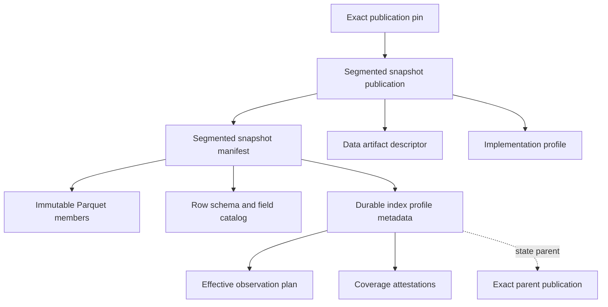

# Portable Durable Index Contract

## Status and boundary

`contract: durable-index/v0` is a **proposed design**, not a frozen contract or
an implementation qualification. The [schema bundle](../../schemas/durable-index/v0/README.md)
and initial logical vectors accompany this draft. The
[conformance requirements](durable-index-conformance.md) distinguishes implemented
logical-corpus publication requirements from later physical adoption gates.

This family defines immutable, self-contained object-inventory snapshots and the
rules for publishing their successors. It composes
[segmented-snapshot/v0](segmented-snapshot-contract.md),
[data-artifact/v0](data-artifact-contract.md) and
[coverage-attestation/v0](../../schemas/coverage-attestation/v0/README.md).
It does not define journals, mutable heads, storage layout, leases, query/acquire
receipts, a general record store, or an analytics table format. A current-state
inventory is not an acknowledged-write history or a source-of-truth claim about
the upstream system. Analytics may derive tables from exact snapshot pins.

Normative MUST rules below describe the candidate. Passing JSON Schema validates
shape only. A producer self-claim, signature, checksum, complete publication or
correct row count does not prove source completeness or correct runtime execution.

## I1 — Composition and immutable selection

The entrypoint is the existing segmented-snapshot `snapshot_publication`,
validated by the durable-index specialization. Both publication and manifest MUST
advertise `contract: segmented-snapshot/v0` and `contract: durable-index/v0`.
A caller pins the publication's exact bytes with the existing binding
`{id, ref, sha256, byte_length}`. The snapshot manifest MUST include
`profile_metadata`, binding an `index_metadata` object with plan, lineage,
coverage and admission evidence. The optional base field is mandatory in this
profile. There is one publication record and one acyclic integrity chain.

All selections MUST agree exactly on namespace, snapshot and artifact. The
namespace is the opaque index-set token; an adopter MUST carry it from the
verified parent, never recompute it from current configuration, format or producer
version. If a producer changes identity-derivation inputs, including schema or
producer version, it MUST either carry the prior set token verbatim or record an
explicit identity cutover binding the old and new tokens and exact publication
pins. A changed token is a new set: without cutover evidence a continuity claim
MUST be refused. A cutover records provenance between sets; it does not permit a
cross-set parent edge or preserve same-set generation numbering. The new set
starts an explicit baseline. The adopter's cutover profile MUST record the
mapping, authorizing actor, acceptance time and rollback pin, and verify that
both tokens agree with the pinned publications. No legacy publication is rewritten.
Each successor uses a new snapshot identity. Physical digest equality
is over stored bytes, with no decode/re-encode step. Duplicate JSON member names,
invalid UTF-8, lone surrogates and non-finite JSON numbers MUST be refused.

The manifest's metadata binding id MUST equal the metadata selection's snapshot
id; its selection MUST equal the manifest's selection. The metadata object MUST
NOT bind the current manifest or publication, which would create a digest cycle.
Plan binding id equals the plan set id; coverage binding ids equal their
attestation ids. The publication is exposed only after every required object,
including the transitive profile metadata, is protected and verified.

Existing segmented-snapshot S1–S8 apply unchanged. Its manifest gains the optional, digest-bound
`profile_metadata` dependency. Existing manifests without it keep their meaning. A consumer that does not support the selected profile MUST refuse the index
interpretation; it cannot ignore required profile metadata and report full
verification. Known-profile selective reads retain their declared limited scope.
The first profile requires a full self-contained snapshot, `count_relation:
equal`, `physical_order: manifest_order`, and a grain counting **all** rows,
including tombstones. Active-object counts are separate derived values.

## I2 — Plan identity and scope

The first scope profile is `unicode-prefix/v0`. A scope is `{namespace, prefix}`;
a row belongs when its namespace is equal and its key begins with prefix by
exact UTF-8 bytes. Empty prefix denotes every key in that namespace. No path
cleanup, trimming, case folding, Unicode normalization, percent decoding or
implicit slash boundary is permitted. A compiler MUST emit the canonical prefix
bytes it intends before binding the plan; a reader MUST NOT clean those bytes.
Serialization and parsing MUST preserve each retained prefix byte-for-byte.
Canonical set sorting, deduplication and containment reduction do not authorize
rewriting individual prefixes. `a` includes `ab`; `a/` does not. A path
subtree compiler must prove exact equivalence to the emitted prefix union. A
selection combining an exact boundary key with a slash-delimited subtree cannot
generally be represented by raw prefix without widening; refuse such a mapping
or define a separately reviewed scope profile. Provider-specific filters and windows
are not v0 scope predicates. A filtered index needs a stable declared keyspace
whose complete enumeration can actually be qualified.

A plan's `set_id` MUST equal the selected namespace. Plan scopes MUST be sorted
by unsigned UTF-8 `(namespace, prefix)`, duplicate-free and prefix-minimal:
remove any scope fully contained by another scope in the same namespace. Empty
plans are permitted and describe no new observation. An empty plan is not an
unknown or unavailable plan. At most 65,536 effective scopes are supported.
Namespace ids use the shared ASCII id vocabulary; prefixes and keys are Unicode
scalar strings of at most 4,096 UTF-8 bytes. Empty object keys are unsupported.

The semantic `plan_digest` is SHA-256 over these bytes:

1. ASCII `durable-index/v0/plan`, followed by one zero byte.
2. The set id, framed as a four-byte unsigned big-endian UTF-8 length and bytes.
3. A four-byte unsigned big-endian effective scope count.
4. For each canonical scope, its namespace then prefix, each length-framed as in
   step 2.

This digest is independent of JSON whitespace, producer configuration identity
and snapshot identity. The plan binding's SHA-256 instead covers the exact JSON
artifact. `effective_scope_count` MUST equal the canonical list length. Readers
refuse noncanonical lists; plan compilers may canonicalize before emitting them.
All fields of the plan are fixed or covered by this digest.

## I3 — Coverage and absence authority

For `baseline` and `observe`, there MUST be exactly one digest-bound
coverage-attestation object per canonical plan scope, in plan order, and no
others. Each has exactly one claim. Its scope is the exact mapping:
`partition: {namespace: <namespace>}`, plus `prefix` when nonempty. The empty
prefix is represented by the partition alone. Window scopes, extra partition
keys and superseding attestations are unsupported in this initial profile.

Every attestation subject MUST equal the snapshot's exact artifact id, grain id
and immutable coverage-subject URI, using segmented-snapshot's subject derivation.
Its emitter relation is `producer`; its run id is the snapshot id; `as_of` equals
`observation_at`. Claim volume is mandatory: `unit: objects`, with integer
`observed` equal to the number of distinct positively observed keys in that
scope. Optional `expected` MUST NOT be less than `observed`; equal counts alone
do not establish completeness. Gaps MUST be within that same plan scope.

A scope grants absence authority only when its attestation has all of:

- `coverage_state: complete`;
- claim `basis: confirmed` and `method: enumerated` or `reconciled`;
- no gaps;
- validated subject, plan binding and observation evidence.

This family uses **one attestation per scope** because coverage-attestation has
an overall completeness field, not a per-claim completeness field. It does not
change that contract. Partial or inferred claims can report positive observations;
they never authorize tombstones. A complete claim with gaps is inconsistent and
MUST be refused. Scope-boundary values and attestations remain protected content;
all composed objects begin from `block_export` and inherit effective protection.

Known plan-discovery failure (failed page, invalid or repeated continuation,
cancellation or exhausted budget) MUST refuse the publication before admission.
A recorded partial observation is distinct from pretending failed discovery
produced a complete effective plan. No acknowledgment overrides either failure
or incomplete observation authority. The plan records what was selected; it does
not prove that a source exposed every eligible prefix or an atomic point-in-time
view.

## I4 — Rows, revisions and observation lineage

The logical row schema defines `(namespace, key)` as the primary key. Every
member and the concatenation of members in manifest order MUST be strictly
increasing by unsigned UTF-8 primary-key comparison. Duplicate keys are refused,
including duplicates split across members. The writer resolves conflicting
observations before publication under a qualified policy; the contract never
silently picks an arbitrary last row. An identical duplicate may be deduplicated
before publication. Observation vectors use unique keys.

`revision` is null or `{kind, value}`. Revision tokens are opaque, scoped to the
key and provider's declared semantics. For example, `opaque-etag` is not a
content hash. `size_bytes` is a nonnegative exact integer up to 2^53−1. Null
last-modified or storage-class means unknown, not zero or an empty value.

All contract timestamps use exactly `YYYY-MM-DDTHH:MM:SS.nnnnnnnnnZ`, real
Gregorian dates (years 0001–9999), seconds 00–59. Nanoseconds are exact; no
truncation or rounding. Unsupported precision or leap-second input requires
explicit refusal/conversion outside this profile, never silent coercion.
Last-modified is source metadata and need not equal or precede observation time.

Observation lineage is `{snapshot_id, at}` in `first_seen`, `last_seen` and
`last_changed`. `deleted` is null for active rows or the stamp that established
a tombstone. First-seen is preserved across disappearance and reappearance.
Last-seen advances only on a positive observation. Last-changed advances on a
change in `(revision, size_bytes, last_modified, storage_class, active/deleted)`;
enrichment does not change it. A new row sets all three stamps to the current
observation stamp. A new tombstone sets deleted and last-changed, preserves
last-seen and first-seen, and keeps prior source metadata. An unchanged existing
tombstone keeps its original deleted stamp. Reappearance clears deleted and
advances last-seen and last-changed.

First-seen MUST not follow last-seen or last-changed. Deletion MUST not precede
last-seen. Observation time MUST not precede any inherited observation/change
stamp. Snapshot ids cannot be reused with new times to fabricate
freshness. A reader checks internal consistency; proving the _transition_ also
requires the exact verified parent and publication inputs.

## I5 — Successors and stale retained state

A baseline has generation 0, null parent, mode `baseline`, admission
`baseline_not_compared`, no acknowledgment, and no inherited rows. It MUST NOT
claim that no scope was lost. A successor binds the exact parent publication
and its selection, carries its set id, and has generation parent + 1.
The current flat snapshot remains readable without reconstructing ancestors.
An ancestor is required for checking a transition, not for reconstructing rows.
Missing parent evidence therefore prevents W2 verification, not an honest R2
snapshot-only result. Parent cycles and same-snapshot successors are refused.

For an observation successor:

1. Admit positive observations only inside the bound plan. They can update
   rows under partial coverage. Positive observation does not grant absence
   authority over other keys.
2. For each parent key not positively observed, create a tombstone only when
   I3 grants authority for that key. Otherwise retain the full logical row,
   including existing tombstone and enrichment, without a fresh stamp.
3. Compare the proposed plan's **effective union** with the exact parent's plan.
   Every old prefix must be contained by a new prefix in its namespace. Counts
   alone are insufficient. Equal-count replacement and net growth can lose scope.
4. A loss requires `admission: loss_acknowledged` and an explicit acknowledgment
   bound to the exact parent and proposed semantic plan digest. Record an opaque
   actor and exact acknowledgment time. The authenticated actor/permission check
   belongs to the qualified publisher. A JSON actor name is not authorization.
   No loss uses `no_loss` and null acknowledgment. Blanket ambient flags do not
   satisfy this record.
5. Recompute `retained_unobserved_rows` as the number of rows whose last-seen
   snapshot is not the current snapshot, **including tombstones**. Preserve their
   old stamps on every later run. An identical reduced plan can have `no_loss`
   while retained rows still lack fresh observations. Neither that status nor
   an acknowledgment means all retained rows were refreshed.

A stale parent at publication admission requires refusal or a complete new
comparison against the admitted parent. Writers MUST persist the exact parent,
plan, coverage and admission decision through recovery. Recovery cannot rediscover
scope, substitute ambient flags, or widen sealed authority. Fencing, conditional
writes, crash recovery, mutation acknowledgment and retention mechanisms remain
implementation-profile obligations; logical vectors cannot qualify them.

## I6 — Enrichment

Each enrichment is a uniquely named nullable string attribute with a source
operation, exact observed-at and non-null `against_revision`. Names are sorted
by unsigned UTF-8 bytes. Values are not interpreted as portable provider facts
without the named adopter profile. Omitted attribute means unobserved; null value
means the source operation observed absence. They are distinct.

An enrichment MUST match the row's non-null revision and may target only an
active row. A positive observation that changes revision, or has unknown revision,
clears prior enrichments; it must not relabel them as fresh. Tombstoning also
clears enrichment, since the target is no longer active. Other updates preserve
valid enrichment. An attribute update at an older time is refused. Timestamp and
matching token alone do not prove that a provider served coherent metadata;
providers must qualify that mechanism.

An `enrich` successor changes only enrichments. It inherits exact plan binding,
semantic digest/count and coverage bindings from the parent, uses
`admission: inherited`, null observation time and null acknowledgment. Coverage
subjects remain the **original** snapshot subjects; do not reissue them under the
new selection. These bindings are inherited observation provenance, not an
attestation about the new snapshot subject under segmented-snapshot S6. The new
subject has no fresh coverage claim. It preserves all row keys, source metadata and observation stamps;
new observations, removals and resurrections are refused. Its
`retained_unobserved_rows` is the total row count, because it observed no key anew.
A subsequent observation successor compares against the inherited plan normally.

## I7 — Encoding, bounds and protected reads

The proposed publication encoding is `parquet-inventory/v0`; the exact column
mapping is in [DDR-0004](../decisions/DDR-0004-durable-index-row-and-plan-encoding.md).
JSON rows in the corpus are logical test inputs, not a second production member
format. Timestamp strings are deliberate: they preserve exact nanoseconds and
the full declared calendar range without silent unit/range conversions. Physical
row counts include tombstones. Packing and row-group sizing are writer choices.

The first profile inherits 65,536 members and 64 MiB aggregate required metadata
from segmented-snapshot, including the additional index metadata, plans and
coverage objects. Per-row and enrichment limits apply before materialization.
Each implementation additionally declares memory, scratch, row-group, decompression,
member-byte, ancestry and input limits; unsupported resources produce capacity
refusal, not a complete empty result. The contract does not promise constant
memory or unlimited history. Required codecs, encodings and encryption support
must be declared and checked before claiming a successful read.

Keys, prefixes, metadata, column statistics and diagnostics inherit protection.
No embedded endpoints, credentials or machine paths in logical references.
A trusted resolver controls storage access. Digests provide integrity relative
to a pin, not provenance authentication or permission to export. Selective or
provisional reads retain segmented-snapshot's limited-scope and terminal-success
requirements; only a verified full scan can claim all-row semantic checks.

## Migration and evidence

Legacy artifacts retain their original bytes, tags and status. A rebuild may
publish a new explicit baseline from fresh observations under the same opaque
set identity. The cutover record binds exact old and new publications separately;
it is not a conforming parent edge and does not imply continuous history. The
operator must explicitly accept this baseline boundary, review scope/retention
changes and retain a rollback pin before retiring old discovery state.

A converter is a separate, qualified producer. It must recover every required
fact from verified evidence; missing plan, revision provenance or completeness
cannot be invented. Unsupported cases refuse. A format rewrite alone neither
refreshes observations nor proves a new baseline. This draft does not specify or
qualify a converter.

An experimental publication may contain logical vectors only. Physical Parquet
twins and independent reader evidence are post-publication adoption gates, not
prerequisites for publishing that limited experimental corpus. It MUST state the
limit explicitly and MUST NOT claim R2 or writer qualification from logical
vectors alone. The contract stays experimental through adoption until a producer
and an independently authored logical reference reader agree against the pinned
corpus, the producer's physical reader agrees with the authored logical twins,
and a second logical workload is exercised. These results establish the stated
logical/physical parity; they do not establish two independent Parquet decoders.
Coverage-attestation remains proposed; composition does not ratify it. See the
[conformance requirements](durable-index-conformance.md) for separate shape,
logical transition, physical reader and runtime qualification gates.
